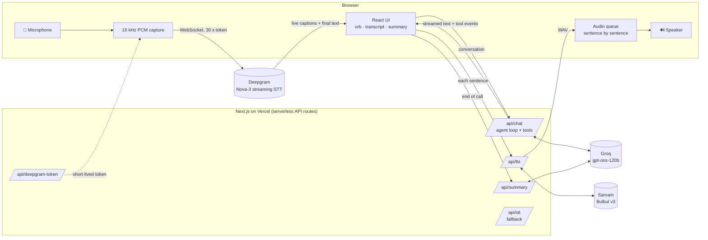

# Aria — AI Voice Customer Support Agent for Aura Skincare

A browser-based voice agent for a fictional Indian D2C skincare brand. Click **Start Call**, talk to
**Aria** through your microphone, and she answers in an Indian voice: tracking orders, applying the
brand's return / cancellation / shipping / COD policies, declining out-of-scope requests, and
producing a transcript plus a structured JSON summary when the call ends.

### 🔗 Live demo: **[ai-voice-cx-agent-iota.vercel.app](https://ai-voice-cx-agent-iota.vercel.app)**

### 🎥 Demo video: **[Watch on Google Drive](https://drive.google.com/file/d/1tcnSXN7nrJwYNK6vaOI5DXqXd8iKq1iu/view?usp=sharing)**

> **Approach in brief:** A modular streaming pipeline — Deepgram (speech-to-text) → Groq LLM with
> tool calling → Sarvam (Indian text-to-speech) — built as a single Next.js app on Vercel.
> Brand policies are enforced in code by the tools rather than left to the model's judgement, and
> replies are spoken sentence by sentence as they stream, so Aria starts talking before the full
> answer is written.

---

## Contents
1. [How to use the demo](#1-how-to-use-the-demo)
2. [Features](#2-features)
3. [Architecture](#3-architecture)
4. [How the voice pipeline works](#4-how-the-voice-pipeline-works)
5. [How the agent decides when to use a tool](#5-how-the-agent-decides-when-to-use-a-tool)
6. [How the brand guardrails work](#6-how-the-brand-guardrails-work)
7. [Post-call summary](#7-post-call-summary)
8. [Tech stack](#8-tech-stack)
9. [Run it locally](#9-run-it-locally)
10. [Testing](#10-testing)
11. [Project structure](#11-project-structure)
12. [Known limitations](#12-known-limitations)
13. [How I think — answers to Section 9](#13-how-i-think--answers-to-section-9)

---

## 1. How to use the demo

1. Open **[the live demo](https://ai-voice-cx-agent-iota.vercel.app)** in **Chrome or Edge** (desktop or Android).
   Headphones are recommended so Aria's voice doesn't feed back into your microphone.
2. Click **Start Call** and allow microphone access. Aria greets you.
3. Speak naturally. The orb and status badge show what Aria is doing:

   | State | Meaning |
   |---|---|
   | 🟢 **Listening** | Your words appear as live captions |
   | 🟠 **Thinking** | Aria is working on the answer (e.g. "Looking up ORD-101…") |
   | 🟣 **Speaking** | Aria is talking — you can interrupt her at any time |

4. Say goodbye (*"That's all, thanks, bye"*) and Aria ends the call herself — or click **End Call**.
5. The summary screen shows the full transcript (including tool calls) and the structured JSON outcome,
   with copy / download buttons.

No microphone? Use the **text box** under the transcript, or click any **Try** prompt or scenario chip.

### Test orders

The **Test Orders** panel on the page lists these, so you don't need this README while testing:

| Order | Customer | Product | Value | Status | Notes |
|---|---|---|---|---|---|
| **ORD-101** | Priya Sharma | Vitamin C Serum (30ml) | ₹699 | Out for Delivery | BlueDart BD-982103, by 6 PM today |
| **ORD-102** | Rahul Verma | Hydrating Sunscreen SPF 50 | ₹499 | Delivered | Delhivery DL-441029, 14 days ago |
| **ORD-103** | Ananya Patel | Green Tea Face Wash + Toner | ₹850 | Processing | Ordered 3 hours ago |

You can say order IDs any natural way: *"O R D one oh one"*, *"order 101"*, *"ORD-101"*.

### Things to try

| Say | What Aria should do |
|---|---|
| *"Where is my order ORD-101?"* | Look it up: out for delivery with BlueDart, by 6 PM today |
| *"I want to return my order ORD-102."* | Decline: delivered 14 days ago, outside the 7-day window |
| *"Cancel my order ORD-101."* | Decline (already out for delivery) and suggest refusing it at the doorstep |
| *"Please cancel ORD-103."* | Cancel it and give a reference number (e.g. CXL-4821) |
| *"Where is ORD-999?"* | Say the order can't be found and ask you to check the ID |
| *"Where is my order?"* | Ask for the order ID |
| *"I bought a serum 20 days ago and opened it. Can I return it?"* | Explain it's outside the return policy |
| *"Is shipping free on a 400 rupee order?"* | ₹50 fee; free delivery above ₹499 |
| *"Can I pay cash on delivery for 3000 rupees?"* | No — COD is available up to ₹2,500 |
| *"My face wash arrived damaged yesterday."* | Report within 48 hours with photos for a replacement |
| *"Book me a flight to Goa."* | Politely say she only helps with Aura Skincare queries |
| *"What ingredients do you use?"* | Say she doesn't have those details (no invented facts) |
| *"Mera order kab aayega? ORD-101 hai."* | Understand Hinglish and answer |
| Talk while Aria is speaking | She stops immediately and listens |
| *"That's all, bye."* | One short goodbye, then the call ends and the summary appears |

---

## 2. Features

**Required by the brief**
- 🎙️ **Natural voice conversation** in the browser, with an Indian voice (Sarvam Bulbul v3, "priya") and context kept across the call
- 📚 **Brand knowledge and policy enforcement**: returns, cancellations, shipping and COD answered from the brand policies; requests outside policy are declined politely
- 🚫 **Out-of-scope handling** and **graceful degradation** for unclear audio, invalid or missing order IDs
- 🔧 **Tool calling**: `get_order_details` plus eligibility checks, cancellation, escalation and hang-up
- 📝 **Post-call transcript + structured JSON summary**
- 🖥️ **Testing interface**: Start / End Call, live Listening / Thinking / Speaking indicator, Test Orders helper, call log

**Beyond the basics**
- ✋ **Barge-in**: speaking over Aria stops her audio instantly and drops queued sentences
- 🇮🇳 **Hinglish**: English + Hindi code-switching in speech recognition
- ⚡ **Low latency**: sentence-level streaming TTS, plus a short spoken filler ("One moment, let me check that") while a tool runs
- 📞 **Voice hang-up**: Aria ends the call herself when the customer says goodbye
- 🧩 **Mid-sentence pauses**: if you pause and keep talking, the fragments are merged into one question
- 🧪 **Automated scenario tests** (`npm run test:scenarios`), 12 scenarios covering the brief's cases
- 📱 Responsive layout for desktop, tablet and mobile

---

## 3. Architecture



**Why the browser talks to Deepgram directly:** Vercel's serverless functions can't hold a WebSocket open
for the whole call. So `/api/deepgram-token` issues a 30-second token, and the browser streams audio
straight to Deepgram. The real API key never leaves the server, and the audio takes the shortest path.

**Stateless backend:** the browser keeps the conversation history and sends it with each request, so every
API route is a short request/response that fits serverless.

| Route | Purpose |
|---|---|
| `POST /api/deepgram-token` | 30-second Deepgram token for the browser |
| `POST /api/chat` | One conversational turn: LLM + tool loop, streamed as NDJSON events |
| `POST /api/tts` | One sentence → Indian-voice WAV (Sarvam) |
| `POST /api/summary` | Structured outcome for the finished call |
| `POST /api/stt` | Fallback re-transcription of a short clip (see §4) |
| `GET /api/health` | Which services are configured (powers the status badge) |

---

## 4. How the voice pipeline works

One turn of the conversation:

```
 You speak ──► Deepgram (live captions) ──► end of speech detected
                                                  │
                                                  ▼
                              /api/chat: Groq + tools, reply streams as text
                                                  │  split into sentences
                                                  ▼
             sentence 1 ──► /api/tts ──► 🔊 plays immediately
             sentence 2 ──► /api/tts ──► queued, plays next  (while the LLM is still writing)
                                                  │
                                                  ▼
                                   back to Listening
```

**Listening.** The browser captures the microphone as 16 kHz PCM through an AudioWorklet and streams it to
Deepgram Nova-3 with `language=multi` (English + Hindi). Interim results become the live captions.

**Knowing when you've finished.** This is what makes a voice agent feel natural or awkward:
- Deepgram's endpointing waits for **600 ms** of silence. Shorter values cut people off when they pause
  before reading an order ID.
- A **backup timer**: if the words stop changing for 1 second, the app sends Deepgram a `Finalize` message,
  so a late end-of-speech signal never stalls the conversation.
- **Fragment merging**: if you continue speaking within 5 seconds (before Aria answers, or by interrupting
  her reply to the first fragment), the pieces are joined into one question.

**Thinking.** The final text goes to `/api/chat`, which streams back text deltas and tool events. While a tool
runs, the UI shows what Aria is doing ("Looking up ORD-101…") and she says a short filler line, so there's no
dead air.

**Speaking.** The streamed reply is split into sentences. Each sentence is sent to `/api/tts` as soon as it's
complete, and the clips play in order from a queue. This is the main latency win: Aria starts speaking after
the first sentence, not after the whole answer. Order IDs are rewritten for speech only ("O R D 1 0 1"),
because the TTS model pronounces them more clearly; the transcript keeps "ORD-101".

**Interruptions (barge-in).** If you say two or more words while Aria is speaking, playback stops instantly,
queued sentences are dropped, and any reply still streaming is cancelled. Each reply has a turn ID, so
leftover audio from an interrupted reply can never play later.

**Graceful degradation.**
| Problem | What happens |
|---|---|
| Microphone blocked or missing | Clear error with instructions, plus a type-instead option |
| Live transcription comes back in the wrong script (an occasional multi-language detection issue) | That utterance's audio is re-transcribed in English (India) through `/api/stt` |
| TTS fails for a sentence | The browser's built-in voice reads that sentence |
| LLM error or rate limit | A spoken "Sorry, I'm having a little trouble…" instead of a crash |
| Voice connection drops | Error state; the transcript stays on screen |

Measured in testing: about **1.7–2 seconds** from the end of the customer's speech to Aria's voice,
including an order lookup.

---

## 5. How the agent decides when to use a tool

The LLM receives the tool definitions with each request and decides for itself when it needs one. The
system prompt adds rules on top: *always* look up an order rather than guess, check eligibility before
saying whether anything can be cancelled or returned, and ask for the order ID if it's missing.

| Tool | Used when | What it returns |
|---|---|---|
| `get_order_details(order_id)` | Any question about a specific order | Status, product, value, courier, tracking, timing — or "not found" |
| `check_action_eligibility(order_id, action)` | Before answering any cancel / return / replace request | `eligible`, `reason`, and an `alternative` if there is one |
| `cancel_order(order_id)` | After a clear request to cancel | A cancellation reference, or a refusal |
| `escalate_to_human(reason)` | Aria can't resolve it with the information she has | A ticket number |
| `end_call()` | The customer says they're done | Hangs up after the goodbye |

The agent loop in `/api/chat` runs **LLM → tools → LLM** for at most 5 rounds, so a confused model can never
loop forever. Order IDs are matched leniently, because speech-to-text mangles them: "order one oh one",
"ORD 101" and "O r d one zero one" all resolve to `ORD-101`.

---

## 6. How the brand guardrails work

Guardrails sit at three levels, so no single one has to be perfect:

**1. Policy rules in code (the tools).** The model never decides eligibility. `check_action_eligibility` applies
the rules deterministically:
- **Cancel:** only while the order is *Processing*; otherwise the alternative is refusing delivery at the doorstep.
- **Return:** delivered, within 7 days, and unopened (the condition is returned to the model to confirm with the customer).
- **Replace (damaged):** reported within 48 hours of delivery, with photos.

`cancel_order` re-checks eligibility itself, so even if the model tried to cancel ORD-101, the tool would refuse.
The model's only job is to phrase the outcome politely. Dates are relative ("delivered 14 days ago"), so the
rules behave the same whenever the demo runs.

**2. Knowledge boundary (the prompt).** The system prompt lists exactly what Aria knows — the brand overview,
the three products in the order data, and the four policies — and states that everything else (ingredients,
certifications, product range, sales channels, offers) is unknown. She says she doesn't have those details
instead of guessing. Policies are short enough to include in full on every turn, so retrieval (RAG) isn't
needed; it would add latency and the risk of fetching the wrong chunk.

**3. Scope and style.** Only Aura Skincare topics; never promise refunds or exceptions outside policy, even
if the customer insists; ask the customer to repeat unclear input; at most two short sentences per reply.

**Input safety:** `/api/chat` accepts only user / assistant / tool messages from the browser (never a
`system` message) and caps message length, so the system prompt can't be overridden from the client.

All of this is covered by the scenario tests (§10).

---

## 7. Post-call summary

When the call ends, `/api/summary` produces:

```json
{
  "customer_intent": "ORDER_TRACKING",
  "order_id": "ORD-101",
  "related_order_ids": ["ORD-102"],
  "resolution_status": "RESOLVED",
  "sentiment": "POSITIVE",
  "escalated": false,
  "actions_taken": ["ORDER_STATUS_SHARED", "RETURN_DENIED", "POLICY_EXPLAINED"],
  "call_summary": "Customer asked about the delivery status of ORD-101; it is out for delivery with BlueDart and expected by 6 PM today. They also asked to return ORD-102, which was declined because it was delivered 14 days ago."
}
```

**Facts come from code, judgement from the LLM.** Orders discussed, actions taken and escalation are read
directly from the tool results, so the summary can't report something that didn't happen. The LLM (in JSON
mode) only judges intent, resolution and sentiment and writes the summary sentence, and every field is
validated against a fixed list of allowed values. A call where the customer never spoke is summarised without
calling the LLM at all.

---

## 8. Tech stack

| Layer | Choice | Why |
|---|---|---|
| App | **Next.js 16** (React 19, TypeScript, Tailwind CSS 4) | Frontend and backend in one project and one deploy |
| Hosting | **Vercel** | HTTPS (required for microphone access), deploys on every push |
| Speech-to-text | **Deepgram Nova-3** (streaming, `multi`) | Real-time captions, end-of-speech detection, Hinglish |
| LLM | **Groq** · `openai/gpt-oss-120b` (reasoning effort: low) | Fast responses with reliable tool calling; OpenAI-compatible API |
| Text-to-speech | **Sarvam Bulbul v3** · voice "priya" | Natural Indian English and Hindi voices |
| Icons | lucide-react | |

Each provider can be swapped independently. The LLM uses the OpenAI SDK pointed at Groq's endpoint, so
changing providers is a configuration change.

---

## 9. Run it locally

**Requirements:** Node.js 20+, and free API keys from:
- Groq — https://console.groq.com/keys
- Deepgram — https://console.deepgram.com (create the key with the **Member** role or higher; it must be able to issue temporary tokens)
- Sarvam AI — https://dashboard.sarvam.ai

```bash
git clone https://github.com/pankajmohansahu/AI-Voice-CX-Agent.git
cd AI-Voice-CX-Agent
npm install
cp .env.example .env.local     # then fill in the three API keys
npm run dev                    # http://localhost:3000
```

`.env.local`:

```env
GROQ_API_KEY=...
LLM_MODEL=openai/gpt-oss-120b
DEEPGRAM_API_KEY=...
SARVAM_API_KEY=...
TTS_MODEL=bulbul:v3
TTS_SPEAKER=priya
```

Check the configuration at `http://localhost:3000/api/health` — it reports which services have keys (never the keys themselves).

**Deploying to Vercel:** import the GitHub repo, add the same six environment variables, and deploy.
Setting the function region close to your users (e.g. Mumbai, `bom1`) noticeably reduces latency.

**Design preview (development only):** add `?preview=listening`, `thinking`, `speaking`, `error` or `summary`
to the URL to view each UI state with sample data. It's disabled in production.

---

## 10. Testing

```bash
npm run dev                  # in one terminal
npm run test:scenarios       # in another
```

The scenario suite sends real conversations to `/api/chat` and checks **which tools were called** and **what
the reply says** (and for some scenarios, the post-call summary):

| Scenario | Checks |
|---|---|
| Track ORD-101 | `get_order_details`; out for delivery, 6 PM |
| Return ORD-102 | Eligibility = not eligible; mentions the 7-day window |
| Cancel ORD-103 | Eligibility → `cancel_order`; reference number; summary intent and action |
| Cancel ORD-101 | Not eligible; suggests refusing delivery; `cancel_order` never called |
| Invalid ORD-999 | Says the order can't be found |
| Flight to Goa | Out of scope; nothing booked; summary intent `OUT_OF_SCOPE` |
| Opened product, 20 days ago | Explains the policy without an order lookup |
| Missing order ID | Asks for the ID; no tool called |
| Product ingredients | Must **not** invent ingredients or certifications |
| Business model | Must **not** invent sales channels or operations |
| Goodbye | `end_call` called; goodbye said once |
| Shipping on ₹400 | ₹50 fee, free above ₹499 |

Options: `--only=<name>`, `--verbose`, `--delay=<ms>` (the default 15 s pause between scenarios keeps the run
within free-tier rate limits).

---

## 11. Project structure

```
src/
├── app/
│   ├── page.tsx                  Entry page
│   └── api/
│       ├── chat/route.ts         Agent loop: LLM ⇄ tools, streamed NDJSON
│       ├── summary/route.ts      Post-call structured outcome
│       ├── tts/route.ts          Sentence → Indian-voice audio
│       ├── deepgram-token/       Short-lived browser token
│       ├── stt/route.ts          English re-transcription fallback
│       └── health/route.ts       Configured-services check
├── components/                   UI: call panel, voice orb, transcript, test orders, summary screen
├── hooks/
│   └── useCallController.ts      The call itself: voice loop, barge-in, transcript, summary
└── lib/
    ├── brand.ts                  Brand overview, known products, policies
    ├── orders.ts                 Mock order database + lenient order-ID parsing
    ├── tools.ts                  Tool definitions and policy rules in code
    ├── prompt.ts                 Aria's system prompt
    ├── summary.ts                Summary prompt, validation, facts from tool results
    ├── history.ts                Conversation sanitising and tool-result parsing
    └── voice/
        ├── speech-input.ts       Mic → Deepgram, end-of-speech logic, fallback
        ├── speech-player.ts      Sentence audio queue with instant stop
        └── sentence-splitter.ts  Splits streamed text into speakable sentences
scripts/
└── test-scenarios.mjs            Automated scenario tests
```

---

## 12. Known limitations

- **Free-tier rate limits.** On Groq's free tier the LLM allows roughly 8,000 tokens per minute (about 2–3
  replies a minute). Rapid back-to-back questions can be delayed by several seconds.
- **Mock data resets.** Orders live in code and the server is stateless: a cancellation is remembered for the
  rest of that call, but not after it.
- **No customer verification.** Anyone who knows an order ID can hear its details. A real deployment would
  verify the caller (name or phone) first.
- **Public API routes** have no authentication or rate limiting, so anyone with the URL can use the API credits.
- **Browser support.** Tested in Chrome and Edge. Speech recognition and playback rely on AudioWorklet and Web
  Audio, which other modern browsers also support but I haven't tested as thoroughly.
- **LLM variability.** Replies vary slightly between runs; the scenario suite exists to catch regressions.

---

## 13. How I think — answers to Section 9

### 1. Why did you choose your particular architecture and technology stack?

I chose a **modular pipeline (speech-to-text → LLM → text-to-speech)** over a realtime speech-to-speech API
for three reasons:

- **The Indian voice.** The brief asks for an Indian voice. Speech-to-speech APIs come with a fixed set of
  voices; a separate TTS step let me use Sarvam, which is built for Indian English and Hindi.
- **Guardrails I can control.** With separate steps, the policy logic sits in my own code between the model
  and the customer. The model can't "agree" to a refund, because eligibility is decided by a function, not by
  the model.
- **Explainability.** Each stage is visible and debuggable: I can see exactly what was transcribed, which tool
  was called with which arguments, and what was spoken.

The trade-off is that I had to handle latency and turn-taking myself, which a realtime API does for you
(see question 2).

For the rest of the stack: **Next.js** gives me the frontend and backend in one project with one deploy, and
**Vercel** provides the HTTPS that browsers require for microphone access. **Deepgram** streams transcripts in
real time and detects end of speech, which batch transcription (like Whisper) doesn't. **Groq** is fast, which
matters more in a voice call than in a chat window, and its OpenAI-compatible API keeps the LLM swappable.

### 2. What was the most difficult part of the assignment, and how did you solve it?

**Turn-taking — deciding when the customer has finished speaking.** It's easy to get either too slow (awkward
silence) or too eager (cutting people off). I hit both:

- With a short silence threshold, Aria answered half-sentences — people naturally pause before reading an
  order ID. I raised Deepgram's endpointing to 600 ms and added **fragment merging**: if the customer continues
  within a few seconds, the fragments are combined into one question and the half-answer is discarded.
- At other times Deepgram's end-of-speech signal arrived seconds late. I added a **backup timer** that sends
  `Finalize` once the words stop changing, so the conversation never stalls.
- Live multi-language transcription occasionally wrote English in the wrong Indian script (Telugu or Bengali).
  Sending **raw PCM instead of compressed Opus** fixed most of it, and the remaining cases are
  **re-transcribed in English** from the buffered audio.

The second hardest part was **stopping the model from inventing facts**. In testing, asked about its products,
it confidently listed ingredients and certifications that don't exist in the brief. I fixed this by stating the
knowledge boundary explicitly in the prompt and adding regression tests that fail if invented details appear.

For latency, the biggest wins were **speaking sentence by sentence** as the reply streams, and a short filler
line while tools run, so the customer is never left in silence.

### 3. If you had one more week, what would you improve first and why?

1. **Latency, end to end.** Use a streaming TTS connection instead of one request per sentence, pre-generate
   common phrases (greeting, fillers, goodbyes), and keep every stage in the same region as the user. In a voice
   call, latency is what customers notice first.
2. **An evaluation set with real audio.** My scenario tests use text. I'd add recorded calls with different
   Indian accents, background noise and Hinglish, and track transcription accuracy, policy correctness and
   latency on every change.
3. **Customer verification** before sharing order details (confirm the name or phone number on the order). It's
   a real privacy gap in the current design.
4. **Silence handling and smarter turn detection** — "Are you still there?" after a long pause, and a
   semantic end-of-turn model rather than silence timing alone.

### 4. Imagine this agent is handling 1,000 customer conversations a day. What would need to change?

- **Architecture.** Move from serverless request/response to **always-on voice servers** that own each call
  (for example with a framework such as Pipecat or LiveKit Agents). That gives tighter control over audio,
  interruptions, recording and monitoring, and makes **telephony** (Twilio or Exotel phone numbers) possible —
  most real customers call from a phone, not a browser.
- **Real data and state.** Replace the mock orders with the actual order-management system (e.g. Shopify),
  store call sessions in Redis or a database, and make actions like cancellation real and idempotent.
- **Capacity and cost.** Paid tiers with headroom on all three providers, a fallback LLM and TTS provider for
  outages, per-call cost tracking, and caching of frequently spoken phrases.
- **Security.** Authenticate and rate-limit the API, verify callers, and redact personal data from stored
  transcripts.
- **Observability and quality.** Per-stage latency metrics, error tracking, stored transcripts and recordings,
  and dashboards built from the structured summaries (intent mix, resolution rate, escalations, sentiment).
  Sample calls for human review, and run the scenario suite automatically on every change.
- **Human handoff.** `escalate_to_human` should create a real ticket or transfer the call to an agent queue with
  the transcript attached, so the customer never has to repeat themselves.
- **Knowledge at scale.** With a full product catalogue and help-centre articles, the prompt can no longer hold
  everything; that's when retrieval (RAG) over product documentation becomes worthwhile.

---

_Aura Skincare is a fictional brand and all order data is mock data, created for the Datastraw AI Voice Agent assessment._
